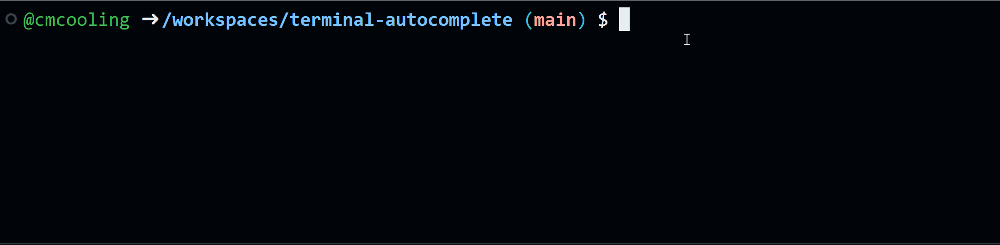

When writing commands in the terminal, you can use <kbd>Tab</kbd> to autocomplete them. The exact behaviour will depend on your shell and the context of the command you are typing.

In the example above, the user types `ls re`{.bash} and then presses Tab to autocomplete the argument of `ls`{.bash}. This finds the directory named `resources` and completes the command.

Using autocomplete can save significant amounts of time when working in the terminal, and also helps reduce typos.

# Try it Yourself

Open up the Codespace using the link at the top of the page. When the terminal is ready, trying typing `ls re`{.bash} and pressing <kbd>Tab</kbd> to autocomplete the name of the directory.
